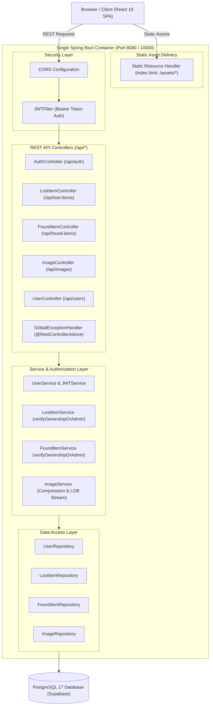

# 🧭 Lostoria

**A full-stack web platform for reporting, tracking, and recovering lost and found items in campus and community environments.**

[](https://github.com/Naveenkus/Lost-Found-Portal/actions/workflows/ci.yml)
[](https://openjdk.org/)
[](https://spring.io/projects/spring-boot)
[](https://www.postgresql.org/)
[](https://react.dev/)
[](https://www.docker.com/)
[](https://github.com/features/actions)

---

## 🌐 Live Demo

🔗 **[https://lostoria.onrender.com/](https://lostoria.onrender.com/)**

> *Hosted on Render's free tier. The instance may take ~30–50 seconds to spin up on the first request after a period of inactivity.*

<!--
SCREENSHOTS: add 2-3 images to docs/screenshots/ and uncomment.
| Feed | Report Item | Item Detail (owner view) |
| :---: | :---: | :---: |
|  |  |  |
-->

---

## ✨ Features

- **Stateless JWT Authentication**: Registration and login via Spring Security, BCrypt password hashing, and 24-hour signed JWTs.
- **Lost & Found Reporting**: Create lost or found listings with multipart photo uploads (`multipart/form-data`) and local datetime preservation.
- **Search & Filtering**: Client-side search across title, location, and description, with status filtering (All, Lost, Found).
- **Ownership-Based Authorization**:
  - `PUT` / `DELETE` on an item are restricted to the user who reported it.
  - `Role.ADMIN` can moderate any listing.
  - Unauthorized mutations return `403 Forbidden`.
- **In-Database Image Pipeline**: Images are compressed with `Deflater`, stored as PostgreSQL Large Objects (`@Lob`), and streamed by ID (`/api/images/view/id/{imageId}`).
- **Global Error Handling & Validation**: A central `@RestControllerAdvice` returns a consistent `ErrorResponse` envelope (`{ timestamp, status, error, message, path, errors? }`), backed by Jakarta Bean Validation (`@NotBlank`, `@Size`, `@Email`).
- **Single-Port Unified Deployment**: The React SPA is built into Spring Boot's static resources, so the whole app ships as one container on one port.
- **CI Pipeline**: GitHub Actions builds and tests the project on every push and pull request.

---

## 🛠️ Tech Stack

### Backend
- **Language**: Java 21 (LTS)
- **Framework**: Spring Boot 3.4.5
- **Security**: Spring Security 6, JJWT (`0.12.6`), BCrypt
- **Persistence**: Spring Data JPA, Hibernate 6.6, HikariCP
- **Validation**: Jakarta Bean Validation (Hibernate Validator)
- **Database**: PostgreSQL 17 (Supabase pooler / local PostgreSQL)
- **Compression**: `Deflater` / `Inflater` for image byte arrays

### Frontend
- **Framework**: React 18
- **Build Tool**: Vite (outputs to `src/main/resources/static/`)
- **Icons**: Lucide React
- **Styling**: Vanilla CSS, dark glassmorphism design

### Infrastructure & DevOps
- **Containerization**: Multi-stage `Dockerfile` (Maven 3.9 build, Eclipse Temurin 21 JRE runtime)
- **CI**: GitHub Actions (`.github/workflows/`)
- **Database Host**: Supabase (PostgreSQL 17)
- **Application Hosting**: Render

---

## 🏛️ Architecture

Lostoria runs as a single container. The compiled React SPA (`index.html`, JS, CSS) is packaged into Spring Boot's static resources. One server handles REST requests under `/api/**`, validates JWTs in `JWTFilter`, enforces data ownership in the service layer, and serves the frontend on the same port.



---

## ⚖️ Design Decisions & Trade-offs

| Decision | Why | Trade-off |
| :--- | :--- | :--- |
| React built into Spring Boot static resources | One container, one port, no CORS or second deployment to manage | Frontend changes require a rebuild and repackage |
| Images stored in PostgreSQL (`@Lob`) | Free-tier hosts have ephemeral filesystems, and this needs no extra storage service | Database growth and heavier queries; object storage (S3-style) is the production-grade choice |
| Stateless JWT instead of server sessions | Horizontally scalable, no session store | No server-side revocation before the 24h expiry |
| Ownership check in the service layer (`verifyOwnershipOrAdmin`) | Rule is enforced regardless of which controller calls it, and is unit-testable | Every new mutation path must remember to call it |
| `ddl-auto=update` for schema changes | Fast iteration for a solo project | No versioned migrations; Flyway/Liquibase is the production approach |

---

## 📡 API Overview

### Authentication (`/api/auth`)
| Method | Path | Auth Required | Description |
| :--- | :--- | :--- | :--- |
| `POST` | `/api/auth/register` | No | Register a new user with validated username, email, and password |
| `POST` | `/api/auth/login` | No | Authenticate with username/email and password; returns JWT + user profile |

### Lost Items (`/api/lost-items`)
| Method | Path | Auth Required | Description |
| :--- | :--- | :--- | :--- |
| `GET` | `/api/lost-items` | No | Retrieve all lost item listings |
| `GET` | `/api/lost-items/{id}` | No | Retrieve a single lost item |
| `POST` | `/api/lost-items` | Yes (Bearer JWT) | Report a lost item with optional multipart photo (`reportedBy` set automatically) |
| `PUT` | `/api/lost-items/{id}` | Yes (Bearer JWT) | Update a lost item (owner or ADMIN only; 403 otherwise) |
| `DELETE` | `/api/lost-items/{id}` | Yes (Bearer JWT) | Delete a lost item (owner or ADMIN only; 403 otherwise) |

### Found Items (`/api/found-items`)
| Method | Path | Auth Required | Description |
| :--- | :--- | :--- | :--- |
| `GET` | `/api/found-items` | No | Retrieve all found item listings |
| `GET` | `/api/found-items/{id}` | No | Retrieve a single found item |
| `POST` | `/api/found-items` | Yes (Bearer JWT) | Report a found item with optional photo (multipart or JSON) |
| `PUT` | `/api/found-items/{id}` | Yes (Bearer JWT) | Update a found item (owner or ADMIN only; 403 otherwise) |
| `DELETE` | `/api/found-items/{id}` | Yes (Bearer JWT) | Delete a found item (owner or ADMIN only; 403 otherwise) |

### Images (`/api/images`)
| Method | Path | Auth Required | Description |
| :--- | :--- | :--- | :--- |
| `GET` | `/api/images/view/id/{imageId}` | No | Stream decompressed image binary (`image/jpeg`, `image/png`) |
| `POST` | `/api/images/upload/lost/{id}` | Yes (Bearer JWT) | Attach a photo to an existing lost item |
| `POST` | `/api/images/upload/found/{id}` | Yes (Bearer JWT) | Attach a photo to an existing found item |

### Users (`/api/users`)
| Method | Path | Auth Required | Description |
| :--- | :--- | :--- | :--- |
| `GET` | `/api/users` | Yes (Bearer JWT) | List all registered users |
| `GET` | `/api/users/{id}` | Yes (Bearer JWT) | Get user by ID |
| `PUT` | `/api/users/{id}` | Yes (Bearer JWT) | Update user profile |
| `DELETE` | `/api/users/{id}` | Yes (Bearer JWT) | Delete user by ID (returns `204 No Content`) |

---

## 🧪 Testing & CI

Run the test suite locally:

```bash
./mvnw test          # Linux / macOS
.\mvnw.cmd test      # Windows
```

Tests cover the item-creation flow, the full ownership/authorization matrix (owner, non-owner, admin, legacy items with no owner), the global exception handler, and Bean Validation failures.

**CI (GitHub Actions)**: the workflow in [`.github/workflows/`](.github/workflows/) runs on every push and pull request to build the project and run the tests, and the status badge at the top of this README reflects the latest run on `main`.

<!-- TODO: replace the sentence above with the exact steps of your workflow, e.g. "checks out code, sets up JDK 21 with Maven cache, runs ./mvnw verify, builds the Docker image". If a deploy step exists, state it plainly (e.g. "Render auto-deploys from main"). -->

---

## 🚀 Getting Started Locally

### Prerequisites
- **Java 21 JDK** with `JAVA_HOME` configured
- **Node.js 18+** and **npm** (frontend build)
- **PostgreSQL 17** (local or a cloud database such as Supabase)
- **Docker** (optional)

### 1. Clone the Repository
```bash
git clone https://github.com/Naveenkus/Lost-Found-Portal.git
cd Lost-Found-Portal
```

### 2. Configure Environment Variables
```bash
# PostgreSQL connection
export DB_URL="jdbc:postgresql://localhost:5432/postgres"
export DB_USERNAME="postgres"
export DB_PASSWORD="your_postgres_password"

# JWT signing secret (Base64). Local dev falls back to a built-in development secret
# if unset. ALWAYS set your own in any deployed environment.
# Generate one with: openssl rand -base64 64
export JWT_SECRET="your_512_bit_base64_secret_key"
```

### 3. Build & Run (Local Java Runtime)

Build the frontend:
```bash
cd frontend
npm install
npm run build
cd ..
```

Run the application:
```bash
# Windows
.\mvnw.cmd spring-boot:run

# Linux / macOS
./mvnw spring-boot:run
```

The app is available at `http://localhost:8080`.

### 4. Run via Docker

```bash
docker build -t lostoria:latest .
docker run -p 8080:10000 \
  -e DB_URL="your_database_jdbc_url" \
  -e DB_USERNAME="your_database_username" \
  -e DB_PASSWORD="your_database_password" \
  -e JWT_SECRET="your_512_bit_base64_secret_key" \
  lostoria:latest
```

Open `http://localhost:8080` in your browser. (The container listens on port `10000`, mapped to `8080` on your machine.)

---

## 📁 Project Structure

```text
lostoria/
├── .github/workflows/                    # GitHub Actions CI pipeline
├── pom.xml                               # Maven config (Java 21, Spring Boot 3.4.5)
├── Dockerfile                            # Multi-stage Docker build
├── frontend/                             # React 18 + Vite source
│   ├── src/
│   │   ├── components/                   # Navbar, ItemCard, ItemModal, EditModal, ReportModal, AuthModal
│   │   ├── api.js                        # Central Fetch client with Bearer auth injection
│   │   ├── App.jsx                       # Feed state and modal orchestration
│   │   └── main.jsx                      # React entrypoint
│   ├── vite.config.js                    # Builds into ../src/main/resources/static/
│   └── package.json
└── src/
    ├── main/
    │   ├── java/com/example/lostoria/
    │   │   ├── config/                   # SecurityConfig (JWT filter, CORS, DaoAuthProvider)
    │   │   ├── controller/               # Auth, LostItem, FoundItem, Image, User controllers
    │   │   ├── dto/                      # UserPrincipal, ErrorResponse
    │   │   ├── exception/                # GlobalExceptionHandler (@RestControllerAdvice)
    │   │   ├── model/                    # JPA entities: User, LostItem, FoundItem, Image
    │   │   ├── repository/               # Spring Data JPA repositories
    │   │   ├── security/                 # JWTFilter, MyUserDetailsService
    │   │   ├── service/                  # Business logic, ownership checks, image compression
    │   │   └── util/                     # ImageUtility (Deflater/Inflater), Role enum (USER, ADMIN)
    │   └── resources/
    │       ├── application.properties    # Config and environment variable mappings
    │       └── static/                   # Compiled React production bundle
    └── test/                             # Unit and web-layer tests
```

---

## 🗺️ Roadmap & Tracked Decisions

- **Role guards on `/api/users`**: Add `@PreAuthorize("hasAuthority('ADMIN')")` to user administration routes.
- **DTO projection for public feeds**: Mask reporter email and internal user IDs on `GET /api/lost-items` and `GET /api/found-items`.
- **Login query optimization**: Remove the redundant user lookup in `AuthController.login` after authentication.
- **UserController error translation**: Throw `ResponseStatusException(HttpStatus.NOT_FOUND)` in `updateUser` instead of a raw `RuntimeException`, so clients get a 404 envelope instead of the 500 catch-all.
- **Pagination & server-side search**: Spring Data JPA `Pageable` on both item feeds.
- **Versioned schema migrations**: Replace `ddl-auto=update` with Flyway.
- **Object storage for images**: Move image binaries out of PostgreSQL.