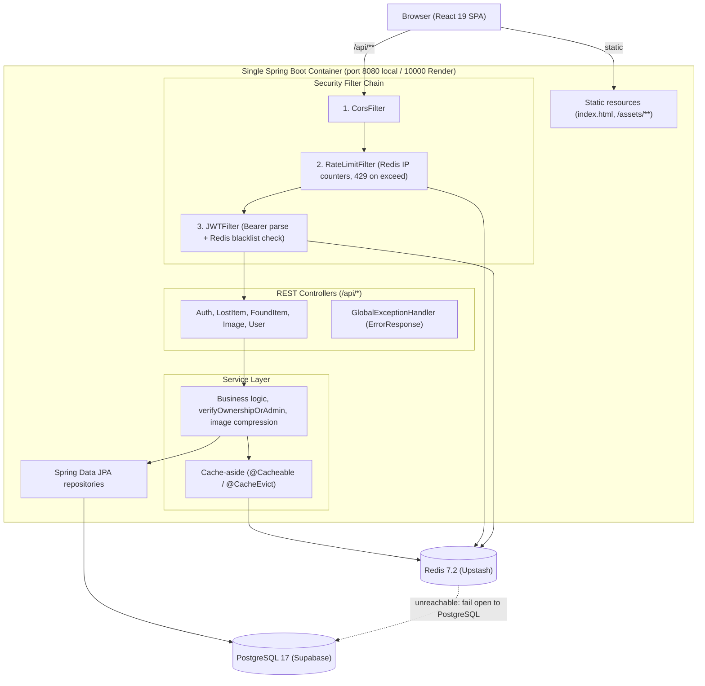

# 🧭 Lostoria

**A full-stack lost-and-found platform for campuses and communities: report, search, and recover items, backed by a Redis-accelerated Spring Boot API with JWT auth, ownership-enforced mutations, and a production CI/CD pipeline.**

[](https://github.com/Naveenkus/Lost-Found-Portal/actions/workflows/lostoria-ci.yml)
[](https://openjdk.org/)
[](https://spring.io/projects/spring-boot)
[](https://www.postgresql.org/)
[](https://redis.io/)
[](https://react.dev/)
[](https://www.docker.com/)

**[Live Demo](https://lostoria.onrender.com/)** · **[Features](#-features)** · **[Architecture](#-architecture)** · **[API](#-api-reference)** · **[Run Locally](#-run-locally)** · **[Design Decisions](#-design-decisions--trade-offs)**

> Hosted on Render's free tier (Supabase PostgreSQL, Upstash Redis). The first request after idle can take ~30–50 seconds while the instance spins up.

<!--
SCREENSHOTS: add 2-3 images to docs/screenshots/ and uncomment.
| Feed | Report Item | Item Detail (owner view) |
| :---: | :---: | :---: |
|  |  |  |
-->

---

## 📌 Highlights

| Area | What is implemented |
| :--- | :--- |
| **Security** | Stateless JWT (HS256, 24h), BCrypt, Redis token blacklist for logout, per-IP rate limiting, owner/admin authorization in the service layer |
| **Performance** | Multi-level Redis cache-aside (feeds, single items, auth principals, decompressed images) with per-cache TTLs and eviction on write |
| **Resilience** | Fail-open design: if Redis goes down, the app falls back to PostgreSQL instead of failing requests |
| **Quality** | 36 automated tests, standardized error envelope, Jakarta Bean Validation, GitHub Actions CI with Docker build check |
| **Delivery** | Single multi-stage Docker image serving API and React SPA on one port; auto-deploy to Render |

---

## ✨ Features

- **Stateless JWT authentication**: registration and login via Spring Security 6, BCrypt hashing, 24-hour HMAC-SHA256 signed tokens.
- **Lost and found reporting**: create listings with multipart photo upload (`multipart/form-data`) and local datetime preservation.
- **Search and filtering**: client-side search across title, location, and description; status filter (All / Lost / Found).
- **Ownership-enforced mutations**: `PUT` and `DELETE` on items are limited to the reporting user or `ADMIN`. Everyone else gets `403 Forbidden`.
- **Server-side logout (token revocation)**: `POST /api/auth/logout` blacklists the JWT in Redis (`blacklist:<token>`) with a TTL equal to the token's remaining lifetime, so keys clean themselves up.
- **Multi-level Redis caching**: public feeds (5 min), single items (15 min), auth principals (15 min), decompressed images (24 h).
- **Graceful degradation**: a custom `CacheErrorHandler` plus filter-level exception handling fall back to PostgreSQL when Redis is unreachable.
- **Fixed-window IP rate limiting**: atomic Redis counters on login, registration, and item creation.
- **In-database image pipeline**: photos are compressed with `Deflater`, stored as PostgreSQL Large Objects (`@Lob`), cached decompressed in Redis, and streamed by ID.
- **Global error handling and validation**: one `@RestControllerAdvice` returns a consistent `ErrorResponse` envelope, backed by Jakarta Bean Validation (`@NotBlank`, `@Size`, `@Email`).
- **Single-port deployment**: the React SPA is built by Vite into Spring Boot's static resources. One container, one port.
- **CI pipeline**: GitHub Actions runs the full test suite and validates the Docker build on every push and pull request.

---

## 🛠️ Tech Stack

| Layer | Technology |
| :--- | :--- |
| **Backend** | Java 21, Spring Boot 3.4.5 (Web, Data JPA, Security, Validation, Cache) |
| **Security** | Spring Security 6, JJWT 0.12.6, BCrypt |
| **Persistence** | PostgreSQL 17 (Supabase pooler / local), Hibernate 6.6.13, HikariCP |
| **Cache / KV store** | Redis 7.2 (Upstash over TLS in production, Docker locally), Lettuce with Apache Commons Pool 2 |
| **Frontend** | React 19.2, Vite, Lucide React, vanilla CSS (dark glassmorphism) |
| **DevOps** | Multi-stage Docker (Maven 3.9 build, Temurin 21 JRE runtime), Docker Compose, GitHub Actions, Render |

---

## 🏛️ Architecture

One container serves the compiled React SPA and all REST endpoints. Requests pass through three filters in order: CORS, rate limiting, then JWT authentication.



### Redis key map

| Key / cache | TTL | Purpose | Evicted on |
| :--- | :--- | :--- | :--- |
| `lost-items:all` | 5 min | Public lost-items feed | create, update, delete, image upload |
| `found-items:all` | 5 min | Public found-items feed | create, update, delete, image upload |
| `lost-items:single` | 15 min | Lost item by ID | update, delete, image upload |
| `found-items:single` | 15 min | Found item by ID | update, delete, image upload |
| `images:data` | 24 h | Decompressed image bytes (`ImageCacheDto`), avoids repeated zlib inflation and LOB reads | image replaced |
| `users:auth` | 15 min | `UserPrincipal` loaded in `JWTFilter` | user update or delete |
| `blacklist:<token>` | remaining JWT lifetime | Revoked tokens (value `"revoked"`) | auto-expires |
| `ratelimit:<action>:<ip>` | window length | Fixed-window request counters | auto-expires |

### Rate limits

Counters use atomic `INCR`, with `EXPIRE` set on first hit. Exceeding a limit returns `429 Too Many Requests` with the standard error envelope.

| Endpoint | Limit |
| :--- | :--- |
| `POST /api/auth/login` | 5 requests / 1 min |
| `POST /api/auth/register` | 3 requests / 5 min |
| `POST /api/lost-items`, `POST /api/found-items` | 10 requests / 1 min |

### Error envelope

Every error, including validation failures, rate limits, and auth denials, uses one shape:

```json
{
  "timestamp": "2026-10-19T10:15:30",
  "status": 403,
  "error": "Forbidden",
  "message": "You can only modify items you reported",
  "path": "/api/lost-items/42",
  "errors": null
}
```

`errors` is populated with field-level details on `400` validation failures.

---

## ⚖️ Design Decisions & Trade-offs

| Decision | Why | Trade-off |
| :--- | :--- | :--- |
| React built into Spring Boot static resources | One container, one port, no CORS setup, one deployment | Frontend changes require a rebuild and repackage |
| Images stored in PostgreSQL (`@Lob`), cached in Redis | Free-tier hosts have ephemeral disks; no extra storage service needed; Redis removes the repeated inflate and LOB read cost | Database growth and heavier queries. Object storage (S3-style) is the production-grade choice |
| Stateless JWT plus Redis blacklist | Horizontally scalable, and logout still revokes tokens instantly. The key TTL matches token lifetime, so the blacklist never grows unbounded | Revocation depends on Redis. Because the filter fails open, a revoked token is accepted while Redis is down |
| Fail-open on Redis errors | Availability over strictness: a cache outage should not take the app down | Rate limiting and token revocation are not enforced during an outage |
| Fixed-window rate limiting | Two Redis commands, trivial to reason about and test | A client can burst up to 2x the limit across a window boundary. A sliding window or token bucket would be stricter |
| Ownership check in the service layer (`verifyOwnershipOrAdmin`) | Enforced regardless of which controller calls it, and unit-testable | Every new mutation path must remember to call it |
| `ddl-auto=update` | Fast iteration for a solo project | No versioned migrations. Flyway is the production approach |

---

## 📡 API Reference

### Authentication: `/api/auth`

| Method | Path | Auth | Description |
| :--- | :--- | :--- | :--- |
| `POST` | `/api/auth/register` | No | Register a user (validated username, email, password). Rate limited: 3 / 5 min |
| `POST` | `/api/auth/login` | No | Returns JWT and user profile. Rate limited: 5 / 1 min |
| `POST` | `/api/auth/logout` | No | Blacklists the presented JWT in Redis for its remaining lifetime |

### Lost items: `/api/lost-items`

| Method | Path | Auth | Description |
| :--- | :--- | :--- | :--- |
| `GET` | `/api/lost-items` | No | List all lost items (cached 5 min) |
| `GET` | `/api/lost-items/{id}` | No | Get one lost item (cached 15 min) |
| `POST` | `/api/lost-items` | Bearer JWT | Report a lost item, optional multipart photo. `reportedBy` is set from the token. Rate limited: 10 / 1 min |
| `PUT` | `/api/lost-items/{id}` | Owner / Admin | Update an item. Evicts list and item cache |
| `DELETE` | `/api/lost-items/{id}` | Owner / Admin | Delete an item. Evicts list and item cache |

### Found items: `/api/found-items`

| Method | Path | Auth | Description |
| :--- | :--- | :--- | :--- |
| `GET` | `/api/found-items` | No | List all found items (cached 5 min) |
| `GET` | `/api/found-items/{id}` | No | Get one found item (cached 15 min) |
| `POST` | `/api/found-items` | Bearer JWT | Report a found item (multipart or JSON). Rate limited: 10 / 1 min |
| `PUT` | `/api/found-items/{id}` | Owner / Admin | Update an item. Evicts list and item cache |
| `DELETE` | `/api/found-items/{id}` | Owner / Admin | Delete an item. Evicts list and item cache |

### Images: `/api/images`

| Method | Path | Auth | Description |
| :--- | :--- | :--- | :--- |
| `GET` | `/api/images/view/id/{imageId}` | No | Stream decompressed image bytes (cached 24 h) |
| `POST` | `/api/images/upload/lost/{id}` | Bearer JWT | Attach a photo to a lost item |
| `POST` | `/api/images/upload/found/{id}` | Bearer JWT | Attach a photo to a found item |

### Users: `/api/users`

| Method | Path | Auth | Description |
| :--- | :--- | :--- | :--- |
| `GET` | `/api/users` | Bearer JWT | List all users |
| `GET` | `/api/users/{id}` | Bearer JWT | Get a user by ID |
| `PUT` | `/api/users/{id}` | Bearer JWT | Update a profile. Evicts `users:auth` |
| `DELETE` | `/api/users/{id}` | Bearer JWT | Delete a user. Evicts `users:auth` |

---

## 🚀 Run Locally

### Prerequisites

- Java 21 JDK (`JAVA_HOME` set)
- Node.js 18+ and npm
- Docker
- PostgreSQL 17 (local or cloud, such as Supabase)

### Option 1: Docker Compose (fastest)

```bash
git clone https://github.com/Naveenkus/Lost-Found-Portal.git
cd Lost-Found-Portal

# Create .env.local with:
#   DB_URL, DB_USERNAME, DB_PASSWORD, JWT_SECRET
#   REDIS_URL=redis://redis:6379

docker-compose --env-file .env.local up --build
```

Open `http://localhost:8080`.

### Option 2: Host Java runtime with Redis in Docker

```bash
# 1. Redis
docker run -d --name lostoria-redis -p 6379:6379 redis:7.2-alpine

# 2. Frontend build (outputs into src/main/resources/static/)
cd frontend && npm install && npm run build && cd ..
```

Set environment variables, then run with the `local` profile:

```bash
# Linux / macOS
export DB_URL="jdbc:postgresql://localhost:5432/lostoria_local"
export DB_USERNAME="postgres"
export DB_PASSWORD="your_postgres_password"
export JWT_SECRET="$(openssl rand -base64 64 | tr -d '\n')"
export REDIS_URL="redis://localhost:6379"
./mvnw spring-boot:run -Dspring-boot.run.profiles=local
```

```powershell
# Windows PowerShell
$env:DB_URL = "jdbc:postgresql://localhost:5432/lostoria_local"
$env:DB_USERNAME = "postgres"
$env:DB_PASSWORD = "your_postgres_password"
$env:JWT_SECRET = "your_512_bit_base64_secret_key"
$env:REDIS_URL = "redis://localhost:6379"
.\mvnw.cmd spring-boot:run "-Dspring-boot.run.profiles=local"
```

### Option 3: Single Docker image

```bash
docker build -t lostoria:latest .
docker run -p 8080:10000 \
  -e DB_URL="your_jdbc_url" \
  -e DB_USERNAME="your_db_user" \
  -e DB_PASSWORD="your_db_password" \
  -e JWT_SECRET="your_512_bit_base64_secret_key" \
  -e REDIS_URL="redis://host.docker.internal:6379" \
  lostoria:latest
```

The container listens on port `10000`, mapped to `8080` on your machine. Redis is optional: without it the app runs in fail-open mode (no caching, rate limiting, or revocation).

### Environment variables

| Variable | Required | Default (local) | Description |
| :--- | :--- | :--- | :--- |
| `DB_URL` | Yes | `jdbc:postgresql://localhost:5432/lostoria_local` | JDBC URL |
| `DB_USERNAME` | Yes | `postgres` | Database user |
| `DB_PASSWORD` | Yes | none | Database password |
| `JWT_SECRET` | Yes | Dev secret in `application-local.properties` | Base64-URL 256/512-bit signing key. **Always set your own in any deployed environment.** Generate with `openssl rand -base64 64` |
| `REDIS_URL` | No | `redis://localhost:6379` | Use `rediss://` for TLS (Upstash) |
| `PORT` | No | `8080` local / `10000` Render | HTTP port |

---

## 🧪 Testing

36 automated tests across unit, web-layer, and context-boot slices:

| Class | Type | Count | Covers |
| :--- | :--- | :---: | :--- |
| `ItemServiceOwnershipTest` | Unit | 21 | Item creation, `reportedBy` extraction from `SecurityContext`, owner permits, non-owner `403`, `ADMIN` override |
| `GlobalExceptionHandlerTest` | MockMvc | 14 | Error envelopes for 400, 403, 404, 409, 500 |
| `LostoriaApplicationTests` | Integration | 1 | Context loads under the `test` profile with in-memory H2 |

```bash
./mvnw clean test        # Linux / macOS
.\mvnw.cmd clean test    # Windows
```

---

## 🔄 CI/CD & Deployment

**CI** (`.github/workflows/lostoria-ci.yml`) runs on every push and pull request to `main`:

1. Check out the repository.
2. Set up Eclipse Temurin JDK 21 with Maven dependency caching.
3. Run `mvn clean verify` (all 36 tests).
4. Validate packaging with `docker build --platform linux/amd64 -t lostoria:ci .`.

**Hosting**

| Component | Provider |
| :--- | :--- |
| Application container | Render (auto-deploys from `main`) |
| PostgreSQL 17 | Supabase |
| Redis (TLS, `rediss://`) | Upstash |

---

## 📁 Project Structure

```text
lostoria/
├── .github/workflows/lostoria-ci.yml     # CI pipeline
├── docker-compose.yml                    # App + Redis for local use
├── Dockerfile                            # Multi-stage build
├── pom.xml
├── frontend/                             # React 19 + Vite
│   ├── src/
│   │   ├── components/                   # Navbar, ItemCard, ItemModal, EditModal, ReportModal, AuthModal
│   │   ├── api.js                        # Fetch client with Bearer token injection
│   │   ├── App.jsx                       # Feed state, search, modal orchestration
│   │   └── main.jsx
│   ├── vite.config.js                    # Builds into ../src/main/resources/static/
│   └── package.json
└── src/
    ├── main/
    │   ├── java/com/example/lostoria/
    │   │   ├── config/                   # SecurityConfig, RedisConfig (CacheManager, serializers)
    │   │   ├── controller/               # Auth, LostItem, FoundItem, Image, User
    │   │   ├── dto/                      # ErrorResponse, ImageCacheDto, UserPrincipal
    │   │   ├── exception/                # GlobalExceptionHandler
    │   │   ├── model/                    # User, LostItem, FoundItem, Image
    │   │   ├── repository/               # Spring Data JPA repositories
    │   │   ├── security/                 # JWTFilter, RateLimitFilter, MyUserDetailsService
    │   │   ├── service/                  # Business logic, cache invalidation, LOB compression
    │   │   └── util/                     # ImageUtility (Deflater/Inflater), Role enum
    │   └── resources/
    │       ├── application.properties
    │       ├── application-local.properties
    │       └── static/                   # Compiled React bundle
    └── test/                             # 36 automated tests
```

---

## ⚠️ Known Limitations & Planned Fixes

| # | Limitation | Planned fix |
| :-: | :--- | :--- |
| 1 | `/api/users/**` requires authentication but has no role guard, so any authenticated user can perform user administration | `@PreAuthorize("hasAuthority('ADMIN')")` on `UserController` |
| 2 | `POST /api/images/upload/*` checks authentication but not item ownership | Reuse `verifyOwnershipOrAdmin` in `ImageService` |
| 3 | Public item feeds expose reporter email, user ID, and role (password is masked via `@JsonProperty(access = WRITE_ONLY)`) | DTO projection for item feeds |
| 4 | React logout only clears `localStorage`; it does not call `POST /api/auth/logout`, so server-side revocation exists but the UI never triggers it | Wire `Navbar.jsx` logout to the endpoint |
| 5 | `RateLimitFilter` trusts the first `X-Forwarded-For` entry without verifying the upstream proxy | Restrict to trusted proxy CIDRs |
| 6 | `AuthController.login` repeats a user lookup after authentication | Reuse the authenticated principal |
| 7 | `UserController.updateUser` throws a raw `RuntimeException`, which returns 500 instead of 404 | Throw `ResponseStatusException(NOT_FOUND)` |

## 🗺️ Roadmap

- [ ] Resolve the limitations above
- [ ] Spring Data JPA `Pageable` pagination and server-side search on both feeds
- [ ] Flyway migrations to replace `ddl-auto=update`
- [ ] Move image binaries to object storage
- [ ] Sliding-window or token-bucket rate limiting